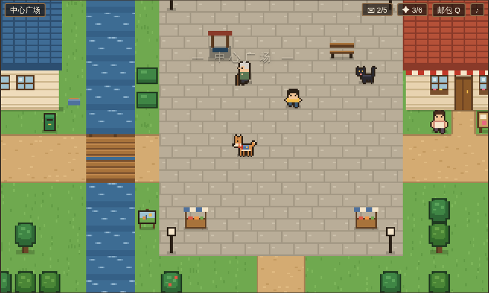

# 阿福的最后一班邮路 · The Last Mail Route

一只邮差狗，替生病的老邮差送完最后五封信。



一款可以直接在浏览器里玩的像素小镇剧情游戏。灵感来自 [daisyh.dev/game](https://daisyh.dev/game)（game-cv）。零依赖、无需构建，推到 GitHub Pages 即可上线；本地双击 `index.html` 也能玩。

- v1.1：5 条主线 + 2 条支线、16 位居民、8 段记忆碎片、12 枚邮票、4 个结局、19 段尾声
- 小镇 + 灯塔岬 + 北林 + 6 个可进入的室内
- v1.2：漂流瓶、失物招领两条支线；黄昏起雾；当前目标提示、地图、跑步、设置（文字速度等）、“有新话”标记
- 狗不会说话：你的每个选择都是一个动作
- 全部像素美术与音效均由代码生成，没有外部素材

## 操作

方向键 / WASD 移动 · Shift 跑步 · 空格 对话 · ↑↓/数字键 选择 · Q 邮包 · M 地图 · X 汪 · P 声音 · F 全屏 · Esc 设置。手机上有触屏按键（含“跑”和“图”）。

## 文档

- [游戏设计文档](docs/01-游戏设计文档.md)
- [故事线与攻略](docs/02-故事线与攻略.md)（含剧透）
- [剧本编写指南](docs/03-剧本编写指南.md)
- [部署指南](docs/04-部署指南.md)
- [版本路线图（v1 → v2 群岛 → v3）](docs/05-版本路线图.md)

## 目录

```
index.html  css/  js/  data/  docs/  cover.png  .nojekyll  .github/workflows/pages.yml
```

剧情全部在 `data/` 里，改文字不用碰引擎。
