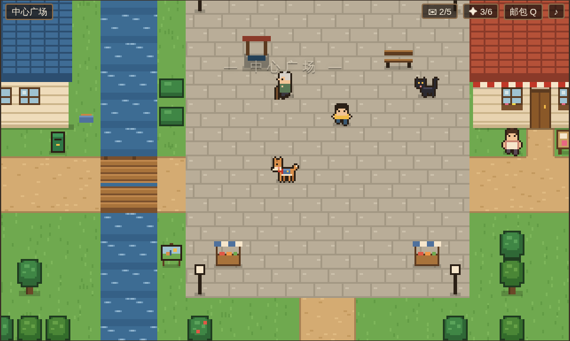
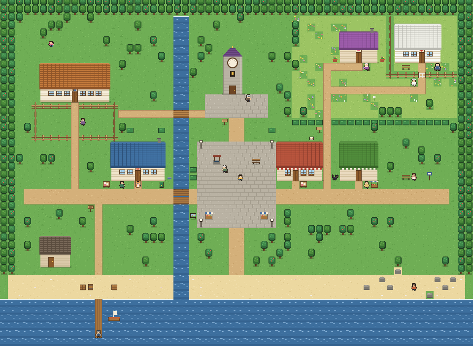

# 《阿福的最后一班邮路》游戏设计文档

> 版本 1.0 · 2026-10-11
> 类型：俯视角像素剧情探索（2D RPG 式小镇漫步）
> 平台：浏览器（桌面键盘 / 手机触屏），静态托管于 GitHub Pages
> 时长：一周目约 25–40 分钟；全结局约 1.5–2 小时



## 1. 一句话概念

**一只邮差狗，替生病的老邮差送完最后五封信。**

栖湾镇的邮差老周送了三十八年信。上个月，他因为阿尔茨海默病住进了山坡上的疗养院。他在邮局抽屉里留下了五封"一定要送到"的信，以及一封写着"阿福 收"的信。阿福，是他养了十一年的狗。

玩家扮演阿福，在一天之内走遍小镇，把信送到五个人手里。每送出一封信，就解开一个人的心结，也找回一段老周的往事。最后，阿福带着这一路找回的记忆上山，去见那个可能已经不认识它的人。

## 2. 参考与取舍

参考作品：[daisyh.dev/game](https://daisyh.dev/game)（基于 game-cv，用 Phaser 把简历做成可以走动、对话的像素小镇）。

| 参考站的做法 | 本作的做法 | 理由 |
|---|---|---|
| Phaser 3 引擎，Vite 打包 | 零依赖原生 Canvas，普通 `<script>` | 不用构建，直接推到 GitHub Pages；双击 `index.html` 也能玩 |
| 世界数据在 `world.json`，需服务器加载 | 数据写成 JS 文件（`data/*.js`） | 本地 `file://` 打开不受跨域限制 |
| 一张横向长图，5 个区域并排 | 60×44 格的完整小镇：河、海、广场、花坡 | 能走出"邮路"的感觉，有远近、有捷径 |
| NPC 是"不同时期的同一个人"，对话树只用来问答 | 12 个各有故事的居民，对话会改变世界状态 | 题目要求"丰富的故事线" |
| 计数"已交谈 x/12" | 计数"信件 x/5、记忆 x/6" + 4 个结局 | 进度和情感目标绑在一起 |
| 像素美术用素材图集 | 所有瓷砖、建筑、角色都用代码画出来，自动描边 | 没有版权问题，改颜色只改一行 |

保留下来的精髓：**像素小镇、走过去按空格对话、对话框逐字出现、选项可以用方向键/数字键选**。

## 3. 设计支柱

1. **狗不会说话。** 阿福所有的"台词"都是动作：【趴下，等】【叼出那张旧合影】【歪头】【汪！】。玩家的选择是"怎么陪伴"，而不是"说什么"。
2. **每封信都晚到了，但还来得及。** 五封信全都指向"今天"：船今天傍晚靠岸，妹妹坐今天的末班车，小雨今天十岁，报到明天截止，四十年没响的钟今天可以再响。老周把它们留到了"该到的那一天"。
3. **记忆是可以送回去的东西。** 老周在忘记一切。阿福送信的路上会想起六段老周的往事，最后在疗养院里，玩家要把这些往事用动作"还给"他。
4. **克制的诱惑。** 黑猫煤球会怂恿你偷看信。偷看能得到线索，但"心是不能偷看的，只能送到"。

## 4. 核心循环

```
读信封上的地址/线索  →  在镇上走、问人、找东西  →  把信送到
       ↑                                              ↓
   新线索、新物品  ←  对方的反应、选择分支、记忆碎片  ←
```

- **送信**：每个收信人都有一条小故事线，有的要先找到人（小雨躲起来了、阿木不在桥下），有的要带上对的东西（旧合影、蒲公英、画），有的要等待（老海）。
- **记忆**：在关键选择上做出"陪伴"的选择，就会想起老周的一段往事（全屏回忆过场）。
- **时间**：每送出一封信，天色就往傍晚推进一档；送完五封后路灯亮起，拆开最后一封信时天色入夜。

## 5. 操作

| 操作 | 键盘 | 触屏 |
|---|---|---|
| 移动 | 方向键 / WASD | 左下方向盘 |
| 对话 / 查看 / 确认 | 空格 / 回车 / Z | A 键，或点对话框 |
| 选择选项 | ↑↓ 或数字键 1–9 | 直接点选项 |
| 汪 | X / B | "汪"键 |
| 邮包（信件、物品、记忆） | Q / Tab / I | 右上"邮包" |
| 声音开关 | M | 右上 ♪ |
| 全屏 | F | — |

面前有能互动的东西时，头顶会出现一个跳动的黄色小箭头，底部提示"空格 · 对话 / 查看"。

## 6. 系统

### 6.1 信件（主线进度）
邮包里有 6 封信：5 封待送 + 1 封"阿福 收"。每封信在邮包里显示收件人、寄件人和**随进度变化的线索**（例如林阿姨那封，会从"面包店在广场东边"逐步变为"去问问隔壁的钱叔"，再变为"她在东边车站"）。送完五封后，"阿福 收"出现【拆开】按钮。

### 6.2 记忆碎片（6 段）
| # | 标题 | 怎么得到 |
|---|---|---|
| 1 | 雨夜的邮袋 | 开场与小吴对话后自动获得 |
| 2 | 码头上的空位 | 在老海身边【趴下，等】 |
| 3 | 没有寄件人的蛋糕 | 把面包店后面的旧合影交给林阿姨 |
| 4 | 提前两年画的圈 | 把花坡上的蒲公英交给小雨 |
| 5 | 墙缝里的信 | 修好钟楼，让陈师傅和苏婆婆在钟楼下重逢 |
| 6 | 路是走出来的 | 把桥头那幅没画完的画交给阿木 |

记忆可以在邮包"记忆"页反复回看。

### 6.3 偷看
煤球每次都会问"要不要看看某封信"。偷看会弹出信的全文，并给一句线索提示；收信人收到时会提示"封口被撕开过"。**偷看 3 封及以上**会进入结局"拆开的信"，**偷看任意一封**都无法达成完美结局。

### 6.4 结局判定（终章：把记忆还给老周）
在疗养院院子里，老周不认识阿福。对话里会出现与你已获得的记忆一一对应的动作选项。每做出一个，老周就想起一点；**做满 5 个**，他会叫出"阿福"。

| 结局 | 条件 |
|---|---|
| 交班（完美） | 叫出名字 + 0 次偷看 + 6 段记忆全齐 + 五条支线都走到最好的分支 |
| 拆开的信 | 偷看 ≥ 3 封 |
| 回家 | 叫出名字（≥5 个记忆动作） |
| 邮路尽头 | 其余情况 |

每个结局后有"后来"尾声：七个角色/地点各自按你的选择显示不同段落（共 14 段可能的尾声）。已解锁的结局记录在浏览器里，标题画面显示收集进度。

### 6.5 存档
每段对话结束自动存档到 `localStorage`，标题画面出现"继续旅程"。结局后存档清除，但结局收集记录保留。

## 7. 世界



60×44 格（每格 16 像素）。河从北向南把小镇分成东西两半，南边是海。

| 区域 | 位置 | 内容 |
|---|---|---|
| 栖湾邮局 | 西侧主路边 | 出生点；小吴、煤球、邮筒、公告栏日历 |
| 栖湾小学 | 西北 | 王老师、操场、学校后面的大樟树（小雨） |
| 码头 | 西南海边 | 栈桥尽头的老海、渔具屋、船 |
| 钟楼 | 正北 | 停在 4:10 的钟、陈师傅 |
| 中心广场 | 正中 | 老井、刘奶奶、阿杰、集市摊位 |
| 商业街 | 广场东 | 林记面包（今日歇业）、钱记小卖部、两店之间的小巷 |
| 车站 | 东 | 公交站与长椅（林阿姨） |
| 花坡 | 东北高地 | 野花、蒲公英、苏婆婆的紫屋顶小屋 |
| 白房子 | 最东北 | 疗养院，篱笆与铁门、何护士、老周 |
| 东滩 | 东南 | 礁石上的阿木 |
| 河边 | 南桥一带 | 桥头的画架 |

## 8. 角色

| 角色 | 身份 | 在故事里 |
|---|---|---|
| 阿福 | 柴犬色的邮差狗，背蓝色邮包 | 玩家 |
| 老周（周守信） | 送了三十八年信的老邮差 | 终章才见到；一直通过信、记忆和别人的话出现 |
| 小吴 | 城里来的临时邮局职员，来了三周 | 引导者；不认路 |
| 煤球 | 邮局门口的黑猫，会说话 | 诱惑者 & 线索提供者 |
| 老海 | 码头的倔老头 | 第一封信：十二年没见的儿子今天回来 |
| 林阿姨（林秀） | 面包店老板娘 | 第二封信：二十年没说话的妹妹 |
| 小雨 | 十岁的小女孩，妈妈两年前去世 | 第三封信：妈妈留给她十岁生日的信 |
| 王老师 | 小雨的班主任 | 线索 |
| 陈师傅 | 守钟人 | 第四封信：四十年前没收到的信 |
| 苏婆婆（苏婉） | 花坡上的独居老人 | 第四封信的寄信人 |
| 阿木 | 桥下画画的年轻人 | 第五封信：美术学院录取通知，明天截止 |
| 钱叔 / 阿杰 / 刘奶奶 | 小卖部老板 / 广场上的男孩 / 井边的老奶奶 | 线索、传闻、老周的旧事 |
| 何护士 | 疗养院护士 | 守门人 |

## 9. 美术与声音

- **分辨率**：内部 320×192，按设备像素比整数倍放大，`image-rendering: pixelated`。
- **美术**：所有图形由 `js/sprites.js`、`js/tiles.js` 逐像素绘制，角色自动加 1 像素深色描边。人物由参数拼装（发型、上衣、围裙、眼镜、拐杖……），新增角色只需写一行外观。
- **昼夜**：7 档色调（早晨→黄昏→入夜），用 multiply 叠加；送满 4 封后路灯亮起。
- **界面**：对话框、邮包、信纸、回忆都是 DOM 覆盖层，中文字体清晰；按舞台宽度等比缩放。
- **声音**：WebAudio 实时合成——打字音、确认、狗叫、拾取、送达小号、记忆琶音、钟声，以及一段五声音阶的背景循环。没有任何音频文件。

## 10. 技术架构

```
index.html            页面骨架与覆盖层
css/style.css         界面样式
js/util.js            命名空间 G、随机数、描边、镜像
js/audio.js           合成音效与背景乐
js/sprites.js         角色精灵（阿福、人类生成器、猫、轮椅上的老周）
js/tiles.js           地形、建筑、钟楼、道具绘制
data/world.js         地图画刷、建筑、道具、区域
data/story-main.js    信件/物品/记忆/过场/角色登场 + 邮局与道具对话
data/story-town.js    五条故事线 + 居民线索
data/story-endings.js 疗养院、终章、结局、尾声
js/state.js           旗标/物品/计数/记忆、条件与效果解释器、存档
js/map.js             生成格子与碰撞，预渲染地面
js/input.js           键盘、触屏、按优先级分发输入
js/dialogue.js        对话引擎
js/ui.js              HUD、提示、过场、邮包、结局字幕
js/game.js            主循环、移动、互动、镜头、昼夜、标题与结局
```

**数据驱动**：所有剧情都是 `data/` 里的纯数据，条件和效果是短字符串（如 `'d:chen & !f:clock_fixed'`、`'i:gear;m:m_sea'`）。写剧本不需要碰引擎代码，详见《剧本编写指南》。

**已验证**：自动化测试（Playwright）走通了全部 4 个结局；检查了所有对话跳转、场景、物品、记忆引用都存在；用广度优先搜索确认每个 NPC、道具和门都能走到。
