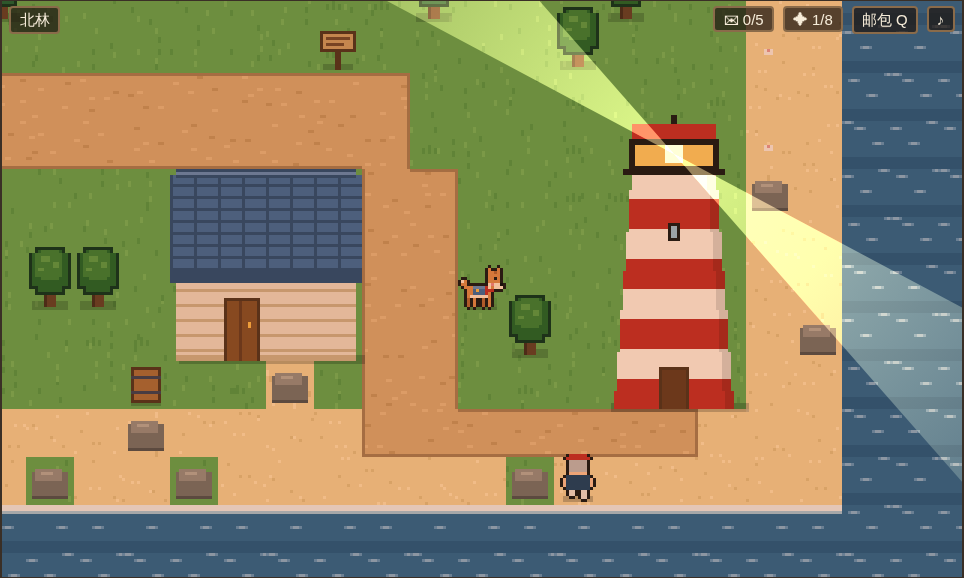
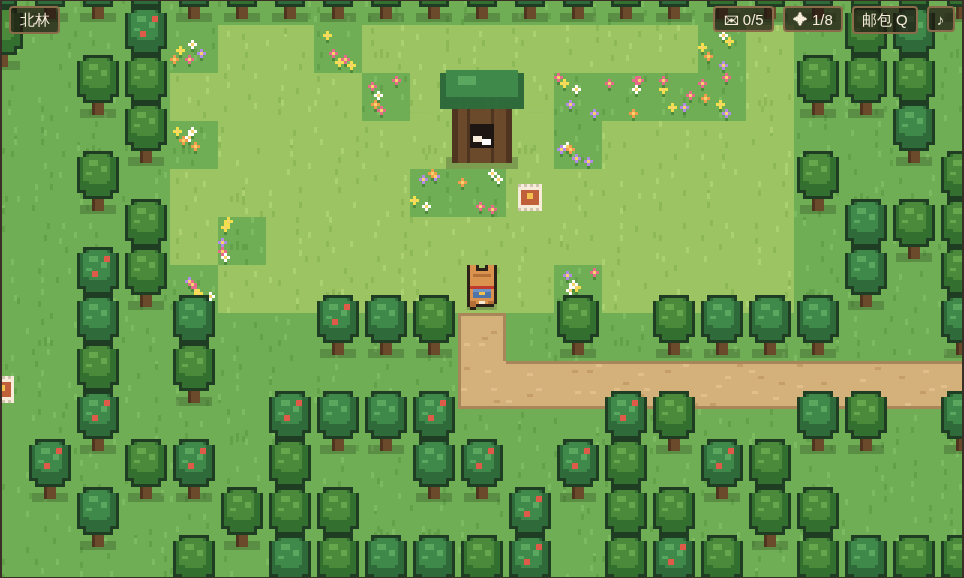
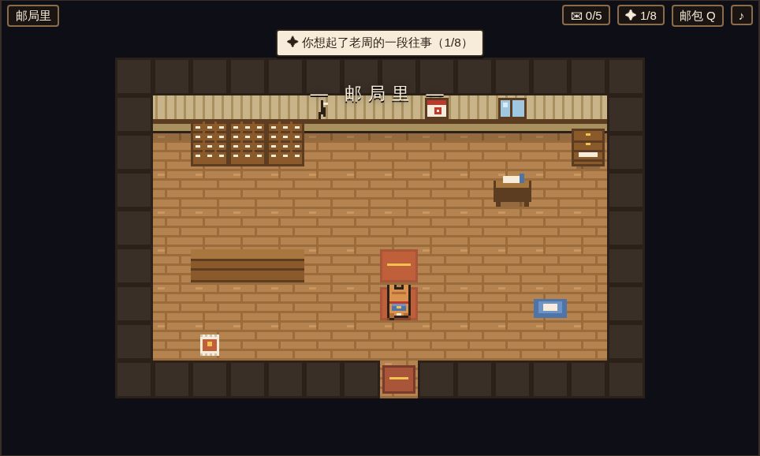

# 《阿福的最后一班邮路》故事线与攻略

> 本文含全部剧透。

## 一、背景

栖湾镇是一个有河、有海、有花坡的小镇。镇上只有一个邮差，周守信，大家叫他老周。他送了三十八年信，"一天没歇过"，台风那年蹚着齐腰深的水把信送到。

十一年前的一个雨夜，邮车送来的最后一个邮袋里，装着一只湿透的小狗。老周给它取名阿福，"有福气的福"。从那以后，栖湾的邮路上总是一个老人、一只狗。

一个月前，老周的记性坏到在镇上迷路，住进了花坡最东边的白房子疗养院。城里派来的临时职员小吴，在他的抽屉里找到五封信，抽屉上贴着："一定要送到。"

**老周的秘密**：这五封信，全都和"今天"有关。他怕自己会忘，把它们留到了"该到的那一天"，在日历上画了五个圈。可他也怕到了那天，自己连日历都看不懂了，于是又写了第六封信，给阿福。

## 二、主线结构

```
序  一定要送到（开场过场）
│   邮局门口：小吴交班 → 记忆①「雨夜的邮袋」
│
├─ 第一封  码头 · 老海 ·········· 十二年没见的儿子，今天傍晚靠岸
├─ 第二封  车站 · 林阿姨 ········ 二十年没说话的妹妹，坐今天的末班车
├─ 第三封  大樟树 · 小雨 ········ 妈妈留给她十岁生日的信
├─ 第四封  钟楼 · 陈师傅 ········ 四十年前没收到的信，钟停在 4:10
└─ 第五封  东滩 · 阿木 ·········· 美术学院录取通知，明天截止
│   （五封顺序自由，可交叉推进）
│
├─ 拆开"阿福 收"（邮包里）→ 天色入夜
├─ 白房子：何护士读到信末的"附：请让这只狗进来"→ 开门
└─ 终章：把记忆一件一件还给老周 → 四个结局之一 → 尾声"后来"
```

## 三、五条故事线

### 第一封 · 码头 · 老海
**信封**：码头尽头，不爱说话的人　**寄自**：远洋货轮"栖湾号"·海生

老海的儿子海生十二年前不顾反对去跑远洋，母亲在他出海时去世。老海对老周说："他的信，退回去。"老周没有退。他把一百四十四封信收在邮局最里面的柜子里。最新这封说：这个月最后一个周六（就是今天）傍晚，船靠岸；"你要是来了，我就知道了。我不会先开口的，我跟你一样倔。"

| 选择 | 结果 |
|---|---|
| 【把信放在他脚边，转身离开】 | 送达。老海没看信，补网的手停住了。之后再来还可以选【趴下，等】 |
| 【在他旁边趴下，等】 | 老海想起老周也是这样陪他坐；读信；把儿子小时候从船钟上拆下的**黄铜齿轮**交给你，"我要等的东西今天就回来了"。→ 记忆②「码头上的空位」 |

**尾声**：等过 → 老海先开口："瘦了。"小吴在柜子里找到那 144 封信，他读了一个冬天。／没等 → 他背对着海假装补网，直到身后有人喊"爸"，网掉进了海里。

### 第二封 · 车站 · 林阿姨
**信封**：面包店的林姐（今天她可能不在店里）　**寄自**：城里·林青

二十年前的今天，妹妹林青从车站坐车去了城里。两人大吵一架，谁也不肯先开口。可每年姐姐生日，邮局都会收到一个没写寄件人的蛋糕盒；每年妹妹生日，姐姐都托老周捎一袋刚出炉的桂花卷——老周替两个犟脾气的人跑了二十年。今天面包店"歇业"，因为林阿姨每年这天都去车站坐一整天。

**寻人线索**：面包店门口的木牌 → 隔壁钱叔："她每年今天都去东边的车站。" → 车站长椅。
**隐藏物品**：面包店后墙根下的**旧合影**（当年她从窗户扔出去的姐妹合照）。

| 选择 | 结果 |
|---|---|
| 【把信放在她手里】 | 送达。"我才不是在等她。"她留在车站。之后带合影回来仍可触发温暖分支 |
| 【叼出那张旧合影】 | 送达。她哭着笑："我是不是太犟了。"回店里烤一炉"烫手的"桂花卷。→ 记忆③「没有寄件人的蛋糕」 |

**尾声**：合影 → "姐，你头发白了。""好香。"第二年招牌上多了一个名字。／没合影 → 妹妹先走过来："姐，我饿了。"姐姐骂了句"活该"，走得很慢，好让后面的人跟得上。

### 第三封 · 大樟树 · 小雨
**信封**：小雨（十岁生日当天交给她）　**寄自**：（没有写寄件人）

两年前的冬天，一个瘦瘦的女人把信交给老周："请在我女儿十岁生日那天给她。我等不到了。"老周提前两年在日历上画了圈。今天，小雨下课就躲了起来——每年生日她都躲。

**寻人线索**：王老师（操场）→ 地上出现三只纸鹤，从学校门口绕到学校背后 → 大樟树下的小雨。广场的阿杰也会"不小心"说漏嘴。
**纸鹤上的字**："妈妈，今天我十岁了。"／"王老师说，十岁是大孩子了，大孩子不可以哭。"／"可是我还是好想你。"
**隐藏物品**：花坡上的**蒲公英**（苏婆婆提过"以前常有一对母女来吹蒲公英"）。

妈妈的信："难过的时候，可以哭。十岁也可以，二十岁也可以。……学校后面那棵大樟树，是你出生那年我种的。"

| 选择 | 结果 |
|---|---|
| （可选）【把纸鹤一只一只放回她手里】 | 集齐三只纸鹤时出现，额外对白 |
| 【安静地靠在她身边】 | "你身上有太阳的味道。" |
| 【把蒲公英递给她】 | 她对蒲公英许愿："妈妈，我十岁了。我过得很好。"→ 记忆④「提前两年画的圈」（之后补交蒲公英也可以） |
| 若已接下钟楼的委托 | 小雨把八音盒里的**铜齿轮**送给你 |
| 【汪！】/【歪头】 | "我以后能帮你送信吗？" 汪 → 她成为**见习邮差**（完美结局条件之一） |

### 第四封 · 钟楼 · 陈师傅 & 苏婆婆
**信封**：钟楼·守钟的人　**寄自**：苏婉（邮戳：四十年前）

四十年前，陈师傅和苏婉约好下午四点在车站见，一起去城里。她没来。他回来后把钟停在了四点十分。其实苏婉被父亲锁在家里，托人寄了一封信："你一个人去城里吧……等你学成了就回来，把钟修好。钟响的那天，我会在钟楼下等你。多久都等。"那封信掉进了邮局分拣柜后面的墙缝。上个月搬柜子时，老周找到了它——想立刻送去钟楼，走到半路，忘了自己要去哪儿。那是他第一次在镇上迷路。

**任务**：送信 → 陈师傅要修钟，缺一个铜齿轮。
**齿轮的三个来源**（任选其一）：
1. 码头老海（【趴下，等】之后给）；
2. 小雨的八音盒（先接下钟楼委托，再给小雨送信）；
3. 问煤球 → 面包店与小卖部之间的小巷里会出现一个"像被谁咬过"的齿轮。

修好后钟声响起（全屏闪光与声波），苏婆婆从花坡走到钟楼下。与她对话触发重逢："现在开口……还来得及吗？""钟都响了。"→ 记忆⑤「墙缝里的信」

**尾声**：重逢 → 每天下午四点十分，钟楼下的长椅上坐着两个老人。／钟修好但没对话 → 紫色屋顶的小屋门开了，后来的事有好几个版本。／没修钟 → 有人看见他背着工具箱，第一次走上花坡。

### 第五封 · 东滩 · 阿木
**信封**：桥下的画家（他叫阿木，头发很乱）　**寄自**：省美术学院 招生办

阿木常在桥头陪老周说话、画画。他在画一幅《邮路》要送给老周：夕阳下的老邮差和背邮包的狗。可老周已经不认识他了，他画不下去，留下一张"不画了。画不出来。"的纸条，跑去东滩发呆。录取通知三个月前就到了，老周替他收着，还附了一张便条："去吧。路是走出来的。"报到截止是明天，今天傍晚有最后一班车。

**寻人线索**：桥头画架（可【小心地把画叼走】）→ 钱叔："他老往东滩礁石那儿跑。"

| 选择 | 结果 |
|---|---|
| 【把那幅没画完的画放在他面前】 | 他在老邮差眼角添了一道笑纹："不是画得多好，是终于敢画完了。"把画《邮路》托你带给老周，去赶末班车。→ 记忆⑥「路是走出来的」 |
| 【歪着头看他】 | "我再想想。"之后带画回来仍可触发 |



### 支线 · 灯塔岬「熄灭的灯」（v1.1）
守灯人唐伯摔了腿，灯塔两个月没亮。今天傍晚"栖湾号"进港——正是载着海生的那条船。
1. 和唐伯对话（小屋门口）→ 礁石那边出现**灯塔钥匙**；
2. 钱叔送你一壶**灯油**（"灯亮了，我请他喝酒"）；
3. 进灯塔，在灯室【用鼻子把油壶推到灯座边】→ 灯亮，入夜后海面有旋转光束；
4. 回去找唐伯 → 记忆⑦「台风夜的灯塔」：台风那年，是老周揣着还是小狗的阿福，爬了一百二十级台阶把灯点亮。
灯塔里还有一箱旧报纸，每张都夹着"老唐，今天的报纸。——周"。
**尾声**：点亮 → "栖湾号"准时进港，钱叔真的提着酒上了岬角。／没点亮 → 船在雾里晚了一个钟头，好在还是到了。

### 支线 · 北林「树洞邮局」（v1.1）
北林老樟树的树洞，是镇上孩子们的秘密邮筒：写给去世的外婆、走丢的猫、十年后的自己。每个礼拜都有"树洞先生"回信——那是老周。他住院后，纸条越塞越多，十七封没人回。
1. 阿杰或护林员阿兰告诉你树洞的事（北林入口在小学东边小路的尽头；岔路口往右，再一直往左）；
2. 在树洞拿到**纸条和回信本**；
3. 交给小吴 → 她读到"狗会说话的，只是它们说的话，只有信得过的人才听得懂"，决定接班 → 记忆⑧「树洞先生」。
**尾声**：树洞里又开始有回信了，署名还是"树洞先生"，只是字迹圆了一些。



### 室内与收集（v1.1）



- **邮局里**：分拣柜（最下面一格贴着"阿福"）、墙缝（四十年前的信从这里掉出来）、日历、老周的工作日志（一段时间线，能看到他的字越写越歪）、阿福的窝。
- **钟楼里**（送信后开放）：缺一个齿轮的机芯；修好后会转。陈师傅的图纸，重逢后多了一张"五点，她来了"。
- **面包店里**（和好后开放）：林阿姨在烤桂花卷；照片墙上空了二十年的相框会放进那张合影；货架上有一个画着狗的小面包，"给阿福"。
- **12 枚邮票**：邮局里、钟楼里、面包店里、灯塔里、大樟树下、栈桥、花坡东侧、东滩、车站旁、树洞旁、林中小池、老井旁。集齐后尾声多一段"邮票册"。

### 支线 · 西滩「海那边的信」（v1.2）
送出第一封信后，西滩会冲上来一个漂流瓶。信是雾岛九岁的阿汐写的：“以前晚上能看见你们那边的灯塔，最近看不见了。”
1. 捡起漂流瓶；
2. 送完小雨的信后，把瓶子交给她，她会写回信（“我们这儿也有一只会送信的狗”）；
3. 把回信瓶交给码头的老海，他把瓶子扔进很远的浪里。
**尾声**：一个月后，渔船捎来阿汐的回信；如果灯塔也点亮了，她会说“灯塔又亮了！”。这也是 v2「雾海群岛」的伏笔。

### 支线 · 车站「失物招领」（v1.2）
车站旁的失物招领箱写着“周守信 代管”，里面有三样东西和老周的纸条：
- 小运动鞋 → “广场上跑得最快的孩子” → 阿杰
- 老花镜 → “井边看报总眯眼的人” → 刘奶奶
- 挂铃铛的钥匙 → “总说自己什么都没丢的那位” → 钱叔
全部物归原主后，尾声里的木牌会换成“阿福 代管”。

### 小游戏 · 广场接飞盘（v1.3）
找阿杰说话，他会邀请你接飞盘：一共扔 6 个，用方向键左右跑，按 Shift 冲刺，按空格跳（跳起来接住的范围更大）。可以反复挑战，6 个全接住会解锁“飞盘高手”成就，还能听到阿杰说周爷爷以前也陪他玩。

### 室内彩蛋（v1.3）
- **苏婆婆的小屋**（花坡）：樟木箱里装着四十年来写给陈师傅、却没寄出的信。钟修好以后，收音机就用不着了。
- **渔具屋**（码头）：墙上有一张雾海群岛的海图（解锁“雾里的岛”成就），桶里装着退回的海生的信。把海生的信送到以后，桌上的马灯会点亮。

### 煤球的诱惑
煤球可以让你偷看任何一封还没送出的信（弹出全文 + 一句线索）。看小雨那封时它自己都会说："这一封，我们不该看的。"

## 四、终章：白房子

1. 送满五封 → 打开邮包拆开"阿福 收"。
   > 我知道你不认字。那你就闻一闻吧，上面有我的味道。……如果我认不出你了，别难过。你就趴在我脚边，像以前在码头那样。我会想起来的。就算想不起来名字，我也会知道，你是我的狗。
   > 附：疗养院的护士同志，请让这只狗进来。它是来交班的。
2. 何护士读到"附"，打开铁门。
3. 老周坐在轮椅上，扣子扣错了一颗。"小狗？你是谁家的小狗？"

**把记忆还给他**：每段已获得的记忆对应一个动作——

| 记忆 | 动作 | 老周想起 |
|---|---|---|
| ① 雨夜的邮袋 | 把湿漉漉的鼻子埋进他手心 | "我好像从雨里捡过什么东西" |
| ② 码头上的空位 | 趴在他脚边 | 海浪，和一个不说话的倔老头 |
| ③ 没有寄件人的蛋糕 | 用爪子咚咚敲两下轮椅 | "不知道谁寄的。其实我知道。" |
| ④ 提前两年画的圈 | 把笔放进他手里 | "那封信……送到了吗？" |
| ⑤ 墙缝里的信 | 竖起耳朵望向钟楼 | 弄丢了四十年的信 |
| ⑥ 路是走出来的 | 把《邮路》放在他膝上（没拿画就绕轮椅走两圈） | "旁边一直有只狗。一直都有。" |
| ⑦ 台风夜的灯塔 | 对着窗外的灯塔轻轻叫一声 | "它一路都没叫。乖得很。" |
| ⑧ 树洞先生 | 把一片樟树叶放在他手心 | "……我好像，听得懂。" |

做满 5 个 → "阿……福。你是阿福。有福气的福。"
随时可以选【把头搁在他的膝盖上】结束。

## 五、结局

| 结局 | 条件 | 最后一句 |
|---|---|---|
| **交班**（完美） | 叫出名字；没偷看过；8 段记忆（含两条支线）；老海【等】、林阿姨【合影】、小雨【见习邮差】、钟楼重逢、阿木【赶车】 | "明天开始，栖湾的邮路，就交给你们了。我们下班吧。" |
| **拆开的信** | 偷看 ≥3 封 | "心是不能偷看的，只能送到。……下次别再拆了啊。" |
| **回家** | 叫出名字 | "好。那我们下班吧。"整个栖湾镇的灯一盏一盏亮起来。 |
| **邮路尽头** | 其余 | "小家伙，你明天还来吗？""那我等你。"有些路走到了尽头，就变成了每天的习惯。 |

## 六、完美结局最短路线

1. 邮局：与小吴对话。
2. 码头：老海【趴下，等】→ 得到齿轮。
3. 面包店后墙根捡旧合影 → 车站：林阿姨【叼出合影】。
4. 花坡捡蒲公英。
5. 小学操场找王老师 → 学校后面大樟树：小雨【信】→【蒲公英】→【汪！】。
6. 钟楼：陈师傅【叼信】→ 再对话【齿轮】→ 钟响 → 和钟楼下的苏婆婆对话。
7. 桥头画架【叼走】→ 东滩：阿木【信】→【画】。
8. 灯塔岬：唐伯 → 礁石捡钥匙 → 钱叔要灯油 → 灯塔顶点灯 → 回去找唐伯。
9. 广场阿杰 → 北林树洞拿纸条 → 回邮局交给小吴。
10. （可选）沿途捡齐 12 枚邮票。
11. 邮包里拆开"阿福 收" → 白房子：何护士 → 老周：依次做 5 个记忆动作。
12. 全程不要让煤球拆信。

## 七、主题

- **守信**：老周的名字叫"守信"。整个故事是一个记性在消失的人，如何靠提前安排和一只狗，守住他最后的承诺。
- **晚到，但还来得及**：每封信都迟了——12 年、20 年、2 年、40 年、3 个月——却都在最后一天赶上了。
- **记忆不只在脑子里**：老周忘了，但镇上每个人都替他记着一部分。阿福把这些碎片带上山，就是把他的一生送回给他。
- **说出口**：五条支线里的人都卡在"谁先开口"。狗不会说话，却让每个人都开口了。
